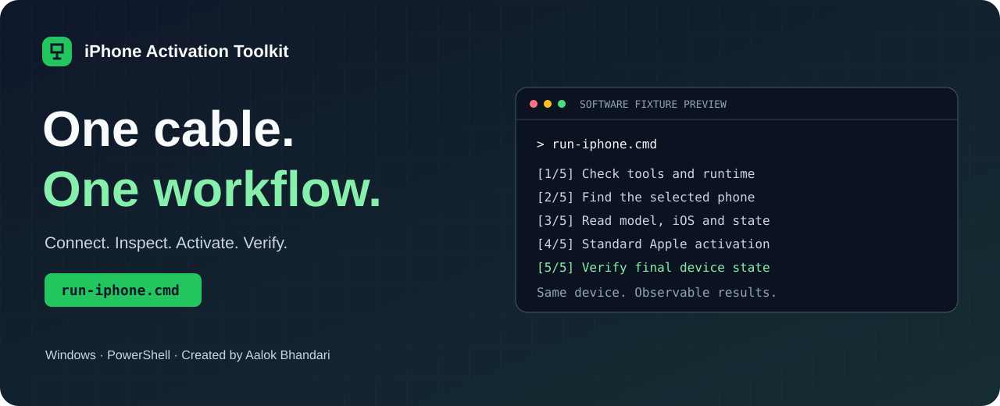
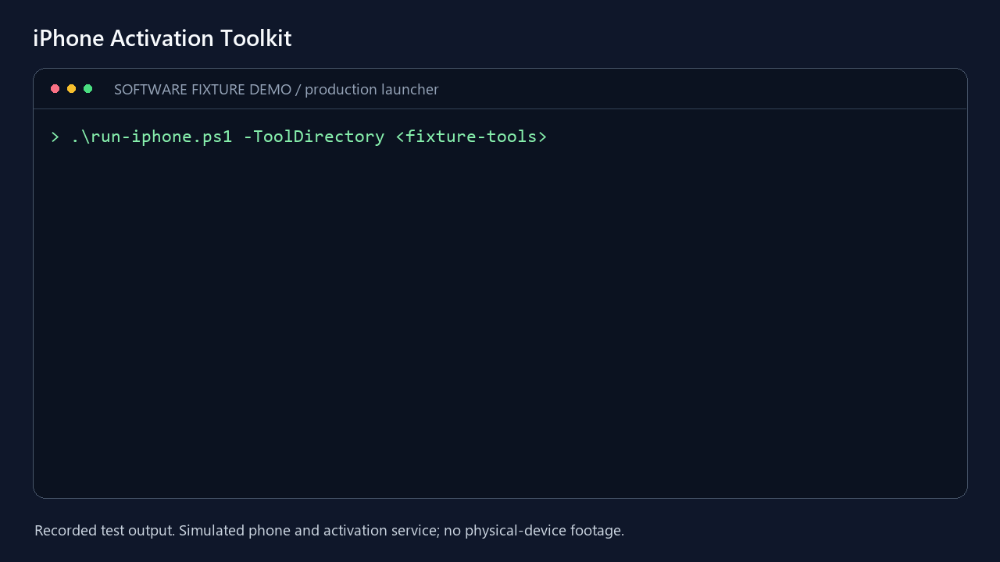
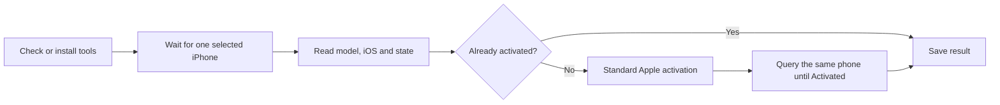

<p align="center">
  
</p>

<p align="center">
  <a href="https://github.com/aalokbhandari/iphone-activation-toolkit/actions/workflows/tests.yml"></a>
  
  
</p>

<p align="center"><strong>Connect your iPhone. Run one launcher. Get a checked result.</strong></p>

Created and maintained by **Aalok Bhandari**.

A Windows workflow for iPhone USB diagnostics, model and iOS discovery, and
standard activation through Apple's service. It sets up its native tools,
keeps every operation tied to the same phone, handles brief connection delays,
and checks the final activation state. No version guessing. No command sequence
to assemble by hand.

[Quick start](#quick-start) · [Complete guide](#what-happens-in-one-execution) ·
[Troubleshooting](#troubleshooting) · [Tests](#test-it) ·
[Architecture and review](WORKFLOW_REVIEW.md)

## See the workflow

<picture>
  <source media="(prefers-reduced-motion: reduce)" srcset="docs/assets/workflow-demo.png">
  
</picture>

The clip renders output captured from the real launcher using test executables.
It is a **software-fixture demonstration**, not physical iPhone footage.
[Static view](docs/assets/workflow-demo.png) · [MP4 clip](docs/assets/workflow-demo.mp4)

## Why this toolkit

- **One launch:** tool setup, connection waiting, inspection, activation, and verification.
- **One selected phone:** no silent switch to another connected device.
- **A checked outcome:** an exit code of zero from the upstream tool is followed by a device-state query.
- **Repeat runs are safe:** an already activated phone skips the activation request.
- **Useful failures:** every saved run identifies its stage and next step.
- **Private summaries:** run reports omit device UDIDs and credential input.
- **Tested failure paths:** actual subprocess fixtures cover disconnects, ambiguity, rejected activation, runtime errors, and timeouts.

## Quick start

### 1. Prepare Windows once

Use Windows 10/11 x64 with Windows PowerShell 5.1, a data-capable USB cable,
an internet connection, and roughly 2 GB of free disk space for first-time
tool setup. Install **Apple Devices** from Microsoft Store, published by Apple,
so the Apple USB driver and device service are available.
[Apple's connection guide](https://support.apple.com/en-us/108643)

Download or clone this repository, and extract the complete folder if using ZIP:

```powershell
git clone https://github.com/aalokbhandari/iphone-activation-toolkit.git
cd iphone-activation-toolkit
```

### 2. Connect and run

Connect the iPhone in **normal mode**. Unlock it and accept **Trust This Computer**
if that prompt is offered. Keep it connected throughout the run.

**Double-click `run-iphone.cmd`.**

Or run the same workflow from a terminal:

```powershell
powershell.exe -NoProfile -ExecutionPolicy Bypass -File .\run-iphone.ps1
```

On the first run, the launcher downloads a checksum-verified portable MSYS2
environment, installs signed packages, and builds the reviewed activation tool.
This can take several minutes. Later runs reuse the installed tools. It installs
under `%LOCALAPPDATA%\tr4mpass-device-tools`; it does not change the system PATH.

Follow any Apple server prompts in the console. Credential input is not saved
by the wrapper. The console stays open when started through the `.cmd` file.

## What happens in one execution



| Stage | Behavior |
| --- | --- |
| Preflight | Starts each required executable to catch missing runtime DLLs before touching the phone |
| Connection | Waits up to 120 seconds by default; multiple phones require explicit selection |
| Device information | Reads `ProductType`, `ProductVersion`, `HardwareModel`, and `ActivationState`; retries briefly if access is delayed |
| Activation | Skips an already activated device; otherwise invokes the upstream standard activation tool once |
| Verification | Tolerates brief query failures and requires the selected device to report `Activated` |

The default result is saved to **`reports/iphone-run.json`**, including timing,
stage, tool versions, model/iOS values, outcome, and any error.

Successful outcomes are `Activated`, `AlreadyActivated`, and, in inspection
mode, `Inspected`. The process exits `0` for a completed workflow and `1` for
failure. A failure report retains the stage at which execution stopped.

## Other useful commands

Inspect the phone without running activation:

```powershell
.\run-iphone.cmd -InspectOnly
```

Select a device when more than one is connected:

```powershell
.\run-iphone.cmd -Udid YOUR_DEVICE_UDID
```

Use an existing compatible native tool directory:

```powershell
.\run-iphone.cmd -ToolDirectory 'C:\AppleTools'
```

Repair the managed tools and continue in the same execution:

```powershell
.\run-iphone.cmd -RepairTools
```

| Option | Default | Purpose |
| --- | --- | --- |
| `-InspectOnly` | Off | Read device information and state without activation |
| `-WaitSeconds` | `120` | Connection-wait budget; `0` makes one detection attempt |
| `-ReadySeconds` | `30` | Device-information retry budget |
| `-VerifySeconds` | `30` | Final-state retry budget |
| `-ToolDirectory` | Auto-detect | Use one explicit directory containing all required native tools |
| `-MsysRoot` | Managed per-user directory | Override the environment used for tool setup |
| `-SkipToolSetup` | Off | Fail instead of installing missing tools; useful for offline runs |
| `-RepairTools` | Off | Rebuild the managed native tools; cannot be combined with an explicit tool directory or skipped setup |
| `-ReportPath` | `reports/iphone-run.json` | Choose a run-report location |

The timeout budgets control retries; an in-flight device query has its own
20-second timeout. Server requests in the managed activation build have a
15-second connection timeout and a 120-second request timeout. Interactive
credential prompts wait for your input.

For a Windows USB-only check, use `start-windows.cmd`. For individual tool
actions, see [GITHUB_INTEGRATION.md](GITHUB_INTEGRATION.md).

## Troubleshooting

| Result | Next step |
| --- | --- |
| Connection timed out | Use a data cable, keep the phone in normal mode, and check that Apple Devices recognizes it |
| Multiple devices connected | Disconnect the other phones or use `-Udid` |
| Device information inaccessible | Unlock the same phone, accept Trust if offered, and check the cable/driver |
| Tool or DLL cannot start | Run `run-iphone.cmd -RepairTools`, or provide a complete compatible `-ToolDirectory` |
| First-time setup download fails | Check internet/proxy access and retry; the installer verifies downloaded source checksums and package signatures |
| Package database is locked | Let the other installation finish; the launcher does not delete package-manager locks automatically |
| Apple server reports failure | Read its response and resolve the account, connectivity, or device requirement it identifies |
| Device never reports Activated | Check its screen and server response; command completion alone is not treated as success |
| PowerShell blocks direct `.ps1` execution | Use the provided `.cmd` launcher or the full command shown in Quick start |

## Test it

Run the Windows diagnostics and complete-launcher fixture tests without a phone:

```powershell
powershell.exe -NoProfile -ExecutionPolicy Bypass -File .\tests\test_windows.ps1
```

On the configured development machine, run all Windows and C tests together:

```powershell
powershell.exe -NoProfile -ExecutionPolicy Bypass -File .\test-project.ps1
```

The full runner needs the separate C test SDK described in
[WINDOWS_TESTING.md](WINDOWS_TESTING.md). On Linux with the development
libraries installed, run `make test test-mocks`. CI checks both Windows workflow
fixtures and Linux C tests.

The recorded local run passed **516 assertions**. See
[TEST_RESULTS.md](TEST_RESULTS.md) for the timestamp and breakdown.

<a id="validation-scope"></a>

## Validation and device reports

Automated validation uses simulated device/network APIs and real subprocess
fixtures. Native executables, managed setup/repair, and HTTPS certificate-bundle
connectivity were also checked on Windows. A physical phone was unavailable
for this validation run. The supported launcher performs standard activation
through Apple's service and retains its account authorization requirements.

The maintainer separately reports removal of existing Activation Lock on
**10 iPhones across different models**. That is a maintainer-reported result;
model/iOS details and reproducible logs have not been supplied. It is not used
as proof of a general unlock capability or a model-support guarantee.
[Device-testing evidence](docs/DEVICE_TESTING.md)

## Project map

```text
run-iphone.cmd / .ps1       One-execution Windows workflow
windows/                   Tool bootstrap, process adapters, diagnostics
tests/                     Windows fixtures and C unit/integration tests
src/ + include/            Original C research implementation and headers
docs/                      Visuals and device-testing evidence
research/                  Corrected evidence and usability report
GITHUB_INTEGRATION.md      Upstream revisions and tool interfaces
WORKFLOW_REVIEW.md         Engineering review and alternative approaches
```

Create the source handoff archive with:

```powershell
powershell.exe -NoProfile -ExecutionPolicy Bypass -File .\package-submission.ps1
```

It writes `submission/iphone-activation-toolkit.zip` and `SHA256SUMS.txt`. Source,
guides, tests, visuals, and the recorded test summary are included. Local device
reports, installed executables, toolchains, credentials, and private working
files are excluded.

## Credits and contributing

The Windows workflow, tests, source transport patch, and presentation are by
**Aalok Bhandari**. The C research code builds on
[tr4m0ryp/tr4mpass](https://github.com/tr4m0ryp/tr4mpass). Device tooling comes
from [libimobiledevice](https://github.com/libimobiledevice/libimobiledevice)
and [libideviceactivation](https://github.com/libimobiledevice/libideviceactivation).
Upstream authorship and applicable notices are retained.

Read [CONTRIBUTING.md](CONTRIBUTING.md) to contribute a reproducible issue or
improve a test. If the toolkit makes your workflow easier, a star helps others
find it. No adoption count, search ranking, or success rate is promised.
